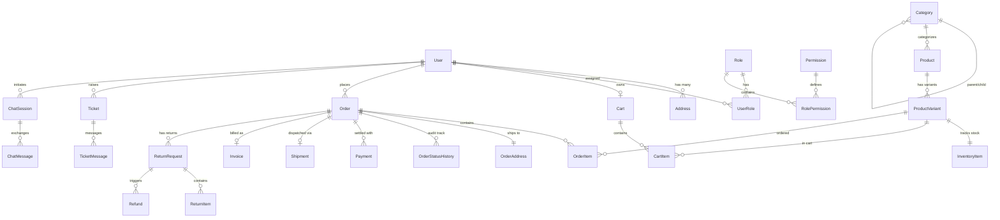

# Database Schema Design & Concurrency Architecture

**Database:** PostgreSQL 16  
**ORM:** Prisma 5.22  
**Core Rule:** "Money and stock are correct first, fast second."

---

## 1. Entity-Relationship Overview



---

## 2. Concurrency & Row-Level Locking Pattern

To prevent race conditions during high-concurrency checkout (e.g. Flash sales, 1 item left with 10 concurrent buyers):

```sql
-- Atomic Inventory Reservation inside PostgreSQL Transaction
BEGIN;

-- 1. Acquire exclusive row lock on physical inventory item
SELECT "id", "quantityOnHand", "reservedQuantity"
FROM "inventory_items"
WHERE "variantId" = $1
FOR UPDATE;

-- 2. Verify availability: (quantityOnHand - reservedQuantity) >= requestedQuantity
-- If insufficient, ROLLBACK immediately with BadRequestException.

-- 3. Atomically increment reservedQuantity
UPDATE "inventory_items"
SET "reservedQuantity" = "reservedQuantity" + $2,
    "updatedAt" = NOW()
WHERE "variantId" = $1;

-- 4. Record stock movement reservation audit
INSERT INTO "stock_movements" ("id", "variantId", "delta", "reason", "reference", "createdAt")
VALUES (gen_random_uuid(), $1, -$2, 'RESERVATION', $3, NOW());

COMMIT;
```

---

## 3. Strict Minor Paise Money Handling

All monetary amounts in the database are stored as **64-bit integer minor units (paise for INR)**:
- ₹1.00 = `100` paise
- ₹1,499.00 = `149900` paise
- ₹1,499.50 = `149950` paise

**Benefits:**
- **Zero IEEE 754 Floating-Point Inaccuracies:** Eliminates rounding drift like `0.1 + 0.2 = 0.30000000000000004`.
- **Database Column Suffix:** All financial columns in tables strictly use the `_minor` suffix (e.g., `price_minor`, `subtotal_minor`, `tax_minor`, `discount_minor`, `total_minor`).

---

## 4. Key Indexing Strategies

| Table | Index Columns | Index Type | Purpose |
|---|---|---|---|
| `users` | `(email)` | UNIQUE B-Tree | Rapid login lookups & unicity |
| `product_variants` | `(productId, sku)` | B-Tree | Fast variant loading by parent |
| `inventory_items` | `(variantId)` | UNIQUE B-Tree | Row-level locking & stock resolution |
| `cart_items` | `(cartId, variantId)` | UNIQUE B-Tree | Item deduplication & atomic upserts |
| `orders` | `(userId, createdAt DESC)` | B-Tree | Fast customer order history listing |
| `orders` | `(orderNumber)` | UNIQUE B-Tree | Instant order tracking & human lookups |
| `orders` | `(status)` | B-Tree | Admin fulfillment workflow filtering |
| `return_requests` | `(orderId, status)` | B-Tree | Customer & admin return management |
| `tickets` | `(status, priority, slaDueAt)` | Composite B-Tree | SLA breach sweeps & agent assignment queues |
| `payment_events` | `(eventId)` | UNIQUE B-Tree | Idempotent webhook event deduplication |
